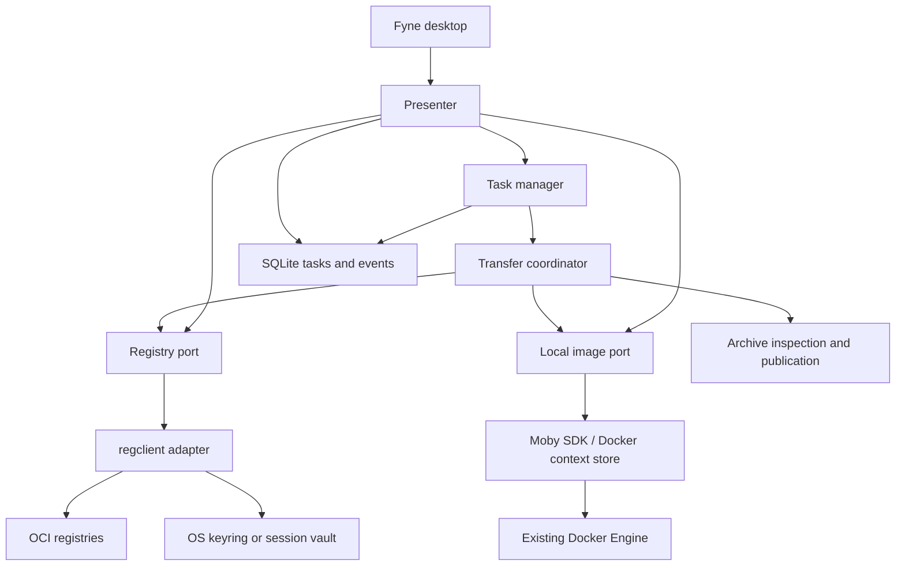

# Architecture

ImagePort separates desktop presentation, application coordination and external
capabilities. Go is used for both the interface and the registry integration.
No web frontend or container execution is involved. Direct registry/archive
operations are daemonless; optional local image operations connect to the user's
existing Docker-compatible engine.

## Boundaries

`domain` owns metadata-only models. `registry.Port` is an application interface,
not an upstream SDK type. The adapter hides SDK version differences and maps
transport errors to safe, stable application error codes.

`task.Manager` is the only owner of transfer goroutines. It persists queued intent
before scheduling, limits concurrency, serializes normalized targets, checkpoints
observed stages, and keeps a logical task's attempts. Read-only UI work runs through
the presenter; Fyne changes from background callbacks use `fyne.Do`.

SQLite transactions contain only metadata writes and events, never network calls.
The UI observes complete current snapshots, so a high-frequency progress channel
cannot displace terminal states. Transfers with unknown totals show stage/activity
instead of an invented percentage.

## Immutable intent

Confirmation captures registry authority, the selected manifest digest, platform,
archive identity and observed target digest. Changing connection credentials can
refresh authentication; changing the registry host or captured account username invalidates new tasks
rather than redirecting them. Retries retain immutable source inputs and require renewed
target checks and consent.

Uploads preserve one selected entry, including its full index. Docker manifests are
normalized by regclient in a private temporary OCI layout to establish the expected
target digest before remote publication. Imports need a private archive snapshot;
Docker normalization requires additional temporary disk space.

## File and archive safety

The scanner streams regular tar members, bounds metadata/resource use, rejects
unsafe paths, links, special members and duplicate names, hashes OCI blobs, checks
descriptor sizes, and validates the referenced graph. Graph walking is bounded,
memoized and cancellable. Layer filesystem contents are not extracted to user paths.

Default inspection limits are 200,000 entries/references, 1 TiB per member, 4 TiB
aggregate member bytes and 32 MiB retained JSON metadata. These are resource-safety
defaults exposed through `archive.Limits`, not a tested capacity claim.

Exports use a unique partial file in the destination directory, sync and close it,
validate its content, then publish using an atomic no-replace hard link. Filesystems
without hard-link support report a publication error; no unsafe overwrite fallback
is used. Crash/power-loss durability and downstream loader compatibility still need
the native acceptance tests.

## Outcomes and recovery

Task states are `QUEUED`, `RUNNING`, `CANCEL_REQUESTED`, `SUCCEEDED`, `FAILED`,
`CANCELLED` and `INTERRUPTED`. A cancellation request remains active until execution
exits and result checks have run. Remote errors, including lost success responses,
are followed by independent digest readback.

On startup, prior active attempts become interrupted. Restored queued tasks wait
for explicit resumption. Reconciliation reads the expected local file or remote
digest before permitting a new attempt. Remote blobs may remain after cancellation;
the application does not delete them or promise rollback.

One process may hold a data directory at a time. Target locks only coordinate this
process, and registry conflict checks are not a distributed transaction or CAS.

## Security and language

Only a secret reference is stored in metadata. Persistent secrets go to the OS
keyring; session storage is explicit. SDK diagnostics are discarded until a
controlled redacting diagnostic sink is available. Application logs identify
task/attempt/stage without logging image credentials.

English is the default for source, UI and documentation. `localization.Catalog`
loads embedded Simplified Chinese messages through go-i18n. The UI remembers the
language preference and refreshes captions in place, preserving entered text,
selections and task execution. Durable task states and errors remain language
independent; translation occurs only at presentation. Literal template parsing
keeps filenames and upstream diagnostics intact. Fyne/platform-owned chooser
internals follow the framework/system locale; unknown diagnostics remain original.

## Desktop workspace

The production window constructs two independent Commander panes and settings.
Each pane owns target/account IDs, browsing context, tree/list state, selected
items, received pages and request generations. Catalog refreshes preserve identity;
changing a location/account invalidates its old responses. UI row models retain
server totals/cursors without slicing received data again. Tag/manifest details
load on demand; the UI does not invent unsupported size or timestamp metadata.

Registry endpoints, filesystem roots and Docker contexts are `domain.Target`
metadata. Registry `Profile` records are separate access accounts bound to a target.
Schema migration groups legacy profiles by endpoint without replacing account IDs
or task references. Initial local locations use a database-scoped initialization
marker. No secret values are stored with targets, profiles, preferences or tasks.

For Harbor, the adapter probes the product API and lists authorized projects, then
repositories within the selected project. These calls use the profile's exact
origin, credentials and CA; redirects are rejected. `X-Total-Count` and numbered
server pages are preserved. Unsupported product APIs fall back to OCI catalog
browsing; authentication/permission failures remain explicit errors.

Local images uses the official Docker context store and Moby SDK, rather than
spawning a Docker CLI process. Docker environment/context precedence is respected.
Context identity is captured without persisting TLS private keys. Non-loopback TCP
connections require verified TLS; local sockets, loopback and SSH are supported.
Local pushes export immutable image IDs to a private archive, inspect it, and use
the normal upload pipeline. Changing a tag does not change queued content. Missing
engines produce actionable connection guidance instead of an empty success state.

Filesystem panes enumerate the selected folder's actual entries within its
resolved root. Regular image archives are inspected on demand. Directory browsing
does not extract archives or follow file symlinks; import execution rechecks a
private snapshot against the reviewed file hash.

## Copy intent

The upper UI presents source selection and destination naming. Local-to-registry
intent maps to a pinned Docker export/upload task; remote-to-file maps to a verified
OCI export; remote-to-registry maps to a digest-pinned copy. Tagging the local source
is optional and is never a prerequisite for uploading it.

Cross-registry tasks retain both saved profile IDs and both confirmed hostnames,
without credentials. Execution rejects changed hosts and creates a regclient SDK
instance with per-host credentials and CA configuration. Same-host copies with different accounts stage a pinned private archive so that
credentials for one host never overwrite the other account in an SDK host map. Destination conflicts are checked before confirmation
and immediately before transfer; independent destination readback verifies success.

Engine destinations normalize the chosen archive root/platform with regclient,
load through the official Moby SDK, and verify the daemon config ID at the exact
tag. The adapter retains caller ownership of archive readers. Local aliases and
Harbor tags use exact tag-removal capabilities; generic manifest-wide deletion
is not substituted. Unknown mutation results require reconciliation before retry.
