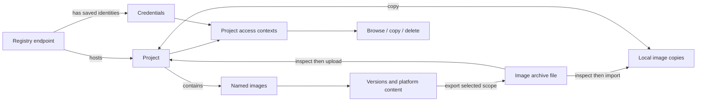

# Projects, images and image files

Status: product/domain proposal, 2026-10-27. This refines the
[user journeys](user-journeys.md); it is not an implementation or migration claim.
The [Chinese discussion companion](project-model.zh-CN.md) explains the same
boundaries using a concrete project example.
The [transfer workspace](transfer-workspace.md) applies these objects to browsing
and copying between two independently navigable locations.

## Product focus

The primary objects are **projects**, **images** and **image archive files**.
Users browse a project, choose an image/version, copy it to another project or
local images, export it to a file, or delete a precisely identified copy.

Registry endpoints and credentials support those actions. A registry is the
service that stores remote project content; a credential is an identity used to
access that service. Keep them as separate objects. Changing the account used to
open a project does not create a second project or move its images.

An upload destination is a **project**, followed by the image name and version.
Show the registry name/address as context so identically named projects can be
distinguished. The upload uses an access context with suitable permission for
that target; the account is inspectable/changeable without becoming the user's
primary destination choice.

## Primary objects

| Object | Definition and identity | Relationship |
| --- | --- | --- |
| Project | A remote project or namespace, identified by registry endpoint and provider project ID (or exact namespace where no ID exists) | Groups remote image repositories; has access contexts for multiple credentials |
| Image | A named family of software-package versions in a project, or an actual local engine image | A project has many named images; local images exist without a remote project |
| Image version | Named reference(s) to selected immutable content and its platform scope | Multiple tags can refer to the same content; a tag can change over time |
| Image copy | Content at an explicit engine, project/repository reference, or archive entry | Copy/delete acts on a specified placement and scope |
| Image archive file | A file containing one or more image entries and platform sets | Export creates a portable snapshot; import selects its contents and destination |

Project membership is not intrinsic to image content. The same content can exist
in multiple projects and locally. A local image need not be assigned to a remote
project before it can be uploaded. A repository-name prefix in a local tag is a
hint, not proof that the image currently exists in that remote project.

A local engine image ID, remote manifest digest, and archive file checksum serve
different purposes. Do not equate them or treat the filename/tag as content
identity. Store the source selection, platform scope and verified result of each
operation. Conversion between archive formats may change representation; record
the actual verification basis rather than assuming every identifier stays equal.

## Supporting objects

| Object | Responsibility | Boundary |
| --- | --- | --- |
| Registry endpoint | Address, provider type, transport/trust configuration and friendly name | One endpoint supports multiple projects and multiple credentials; it contains no account password |
| Credential | Friendly account label, principal, secret reference, storage/lifecycle policy and endpoint scope | One endpoint can have several credentials; secret values stay in secure storage or explicit session memory |
| Project access context | Project + credential/anonymous identity + observed operation capabilities | One project can be accessed through several credentials; one credential can access several projects |
| Operation selection | Exact source, destination, account context(s), platform scope and conflict/deletion consent | Captured for a task; independent of later changes to the account selected elsewhere in the UI |

Capabilities are not a single permanent property of a project or credential.
Track them by identity, project, operation and, when applicable, repository or
reference. Browsing, reading, uploading and deleting are separate capabilities.
Each observed result needs its source and time. Use Allowed / Denied / Unknown /
Sign-in required in presentation; stored preferences cannot grant permission.
Even an allowed project-level operation may encounter a narrower resource policy.
The server's current response remains authoritative at execution.

Public access is an explicit anonymous access context, not an empty invented
credential. Credentials are scoped to their configured endpoint; do not reuse
secrets at another host because a project name or account name matches.



## One project, several accounts

Illustrative example, not live accounts or granted permissions:

```text
Project: Edge · Company registry
  Images
    service-api:1.4
    service-api:1.3
    worker:2.0
  Access
    Read-only account     observed: browse/read
    Release account       observed: browse/read/upload
    Maintenance account   observed: delete at the checked scope
```

These are three access contexts for one project. Do not render three duplicate
projects, union the accounts' permissions into one effective administrator, or
claim all image rows came from the same identity if they did not.

Discover projects under each explicitly configured credential and deduplicate by
remote project identity. Record which account discovered each project. Display
image listings under a clearly selected access context; do not silently combine
accounts' listings. Switching accounts clears or marks stale unreadable contents
and re-fetches them. Project existence survives credential expiry or removal;
access then becomes Sign-in required / No usable account as appropriate.

## Choosing an account for an operation

1. Resolve the user's chosen project and intended action first.
2. Use the user's saved account preference for that project/action if usable.
   If exactly one configured account is suitable, show it as the default.
3. If several accounts are suitable and no preference exists, let the user choose
   once, displaying friendly account names and relevant capabilities. Do not pick
   whichever account has the broadest permissions. Changing account is explicit.
4. Unknown permission does not mean denial. Use non-destructive provider permission
   checks where supported, otherwise disclose that permission is unconfirmed and
   handle the real operation's authorization result. Do not upload/delete test
   content merely to determine permissions.
5. When no usable identity exists, offer Sign in / Add account / Choose another
   project, while retaining the selected image, target name and version.
6. Capture the selected access context for the task. Cross-project copies capture
   independent read and write contexts. A transient failure or denial does not
   silently retry under another, more privileged account.

For the same endpoint, source and destination may require different credentials.
The product model permits this. An adapter must preserve operation-specific
credential isolation; a single host-to-credential map cannot represent both
accounts. If this route is not supported, explain the limitation before creating
the task. Never silently substitute one of the accounts.

Re-entering an expired secret for the same identity may resume its task. Selecting
a different identity requires an explicit change and renewed applicable review.
Changing a project endpoint/path requires a new destination review; it must not
redirect a queued task. Secret rotation changes the secret, not project identity.

## Revised user journeys

### Add projects and accounts

The user can choose Add project from the project list or upload destination picker.
This means making an existing remote project available locally, not creating a
remote project. The setup can add a registry endpoint if missing, add or choose
an account, discover accessible projects, and select which to save/pin. Entering
an exact existing namespace remains available when enumeration is unsupported.

Provide a separate, explicitly named Create remote project action only if supported
and authorized. Do not create a server-side project as a hidden side effect of
adding a local shortcut or importing an image file.

Accounts are added under a registry's access settings or a project's Manage access
entry. Reuse an existing endpoint when adding a second account. Removing an account
removes that credential and preferences, not project content or other accounts.
Removing a pinned project only removes its local shortcut. Deleting remote project
content, or an entire remote project, is a separate operation with distinct scope.

### Upload a local image

1. Select an actual local image/version and choose Copy to project… .
2. Choose the destination project directly, showing its registry as secondary
   context. Filter/search project names and show the full endpoint when needed.
3. Keep or edit the image name and version within that project. Derive the complete
   destination reference; show a readable preview, not a required hand-built URL.
4. Resolve the upload account. Sign in or choose another account when necessary,
   preserving all inputs. Never infer upload permission from project visibility.
5. Review conflicts and selected content/platform scope, then copy and verify.
6. Open the destination project's image/version after success. Local content and
   names remain until the user explicitly deletes the local copy.

Cross-project copying follows the same steps with a remote source project. Source
read and target write permissions are checked separately, including copies between
projects on the same registry. A read-only account can still provide the source.

### Export and import image files

Export starts from a selected image/version, asks for platform scope and a file
location, then produces a verified portable snapshot. The file browser shows its
actual path, format, entries and verified inspection state. One file may contain
multiple images and a multi-platform image may contain several platform manifests.
Do not enforce a one-project/one-image/one-file mapping.

Store provenance when known: original project/endpoint, image name, selected
content and platform scope. Provenance is descriptive, not a permanent binding
or an upload instruction. An externally supplied file may have no known project.
It never contains saved account secrets. A moved/replaced file needs reinspection.

Import inspects the file, selects image entries and chooses local images or a
**destination project**. The same file can populate several projects through
separate copy operations. Permissions and conflicts are evaluated for the current
chosen destination; never automatically overwrite the file's original project.

### Cleanup

Remote cleanup begins inside a specific project under an explicitly selected
access context. Review the affected image versions/names and actual deletion
scope, check deletion permission and re-read the result. Upload permission does
not imply deletion permission. If another account is needed, offer an explicit
switch and review rather than an automatic escalation.

Local image cleanup and deleting an archive file have different scopes. Deleting
a project copy does not silently delete local copies or exported files; deleting
an exported file does not delete its project images. Known provenance helps the
user navigate between them but never creates a cascading-delete relationship.

## Project names across registries and provider differences

Remote identity includes the endpoint: `Team at registry A` and `Team at registry B`
are distinct destinations even if their visible names match. Always disambiguate
them. A future business workspace can group “Test” and “Production” remote targets,
but grouping is an explicit user choice and does not merge accounts or content.

Harbor exposes native projects and project-scoped accounts. Its system robot
accounts can carry permissions across several projects. This supports separating
project identity from access identity. See the official
[project robot account documentation](https://goharbor.io/docs/2.10.0/working-with-projects/project-configuration/create-robot-accounts/)
and [system robot account documentation](https://goharbor.io/docs/2.10.0/administration/robot-accounts/).

The [OCI Distribution Specification](https://github.com/opencontainers/distribution-spec/blob/main/spec.md)
addresses repositories by namespace and manifests by tag/digest; a Harbor-style
project management API is not a universal provider capability. For other providers,
map an actual namespace or an explicitly configured repository collection into the
project view. Identify that mapping; do not infer a native project or shared access
rules solely by splitting the first slash in an image name.

## Acceptance and implementation gap

- The same project discovered by two accounts appears once, with two access contexts.
- A single account can be associated with several projects with different observed permissions.
- Upload chooses a project first, then resolves a suitable account transparently.
- Switching accounts preserves project identity and never merges their permissions.
- Browse, read, upload and delete can independently be allowed, denied or unknown.
- Same-endpoint source/target operations preserve distinct credentials when required.
- Matching project names at different endpoints remain distinct destinations.
- Untagged/local images and external files need no invented remote project membership.
- One archive may contain several images; deleting any one placement never cascades.
- Login expiry, role changes and credential removal preserve user intent and show access state.

The current saved Profile combines endpoint and credential metadata; current tasks
primarily reference Profile IDs. Separating these concepts requires a later model,
storage, adapter and UI migration, preserving old task history and secure secret
references. Current same-host copy restrictions and project/account limitations
remain implementation gaps. Documentation changes do not perform that migration.
