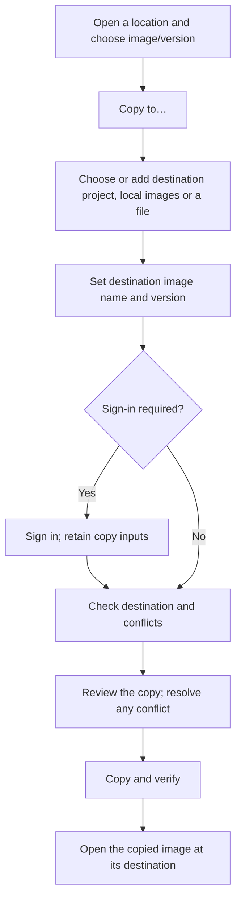

# Image management user journeys

Status: product proposal for discussion, 2026-10-27. This document describes the
intended experience, including capabilities that are not implemented. It does not
approve deletion of any real image. The current application is documented in
[workspace.md](workspace.md). The Chinese discussion companion is
[user-journeys.zh-CN.md](user-journeys.zh-CN.md).

## Audience and purpose

The primary user knows which software package they need to deliver, where it
should go, or which copy they want to remove. They should not need Docker command
syntax, registry protocols, manifest terminology, or knowledge of authentication
mechanisms to complete those tasks.

The product answers four questions throughout the experience: What am I looking
at? Where is it stored? What will this action change? How do I know it worked?
The journeys determine the screens; the existing tabs, drawers and two-pane
workspace do not constrain this proposal.

## A small vocabulary

The [project model](project-model.md) refines the main objects into projects,
images and image archive files. Registry endpoints and credentials are separate
supporting objects; a project can have several independent access contexts.

| User concept | Meaning | Suggested interface wording |
| --- | --- | --- |
| Image | A software package ready to deliver | Image; explain as “software package” on first use |
| Location | A specific placement of image content | Local images; a named project and its registry; an archive file |
| Registry | The service hosting remote projects, independent of the account | Secondary project context; endpoint settings |
| Project | Primary remote upload/browsing destination, distinct from access credentials | Project name, disambiguated by its registry |
| Image archive file | An exported snapshot with one or more image entries | Image files |
| Credential | A scoped account identity used to access projects | Manage project access / Sign in |
| Tag | A version name for an image at a location | Version name; “Tag” in secondary help/details |
| Login | Using an account to access a location | Sign in to this registry |
| Upload / download | The direction in which a copy travels | Copy to…; then show “Uploading” or “Downloading” |
| Cleanup | Removing explicitly chosen copies or version names | Delete from [location], with exact scope |

An image is the content being copied. A tag names a version at a location; it is
not itself a location. Multiple names can refer to the same content. A local image
ID and a remote manifest digest are technical evidence, not the primary user name.
Use a friendly image name, version and location first, with details available.

For example, “Copy **Order service · Version 1.4** from **On this computer** to
**Test project · Company registry**” communicates the user's intent. The complete technical
reference remains visible in the destination review and copyable in details.
Example names in this document are illustrative and must not become seeded data.

## Shared behavior

Local images, projects and image files are the main working collections. Remote
copy destinations select a project directly; the registry provides address and
service context, while a separate access context supplies the account. A project
can be discovered through multiple accounts without appearing as duplicates.
Adding a missing project from the destination picker can include endpoint setup
and sign-in, then return to the original copy. No screen arrangement is prescribed.

The [transfer workspace proposal](transfer-workspace.md) develops these journeys
into a Commander-style workspace with one concrete-target dropdown per pane,
a shared target manager, expandable trees/lists and a transfer queue. It preserves project destinations and
separate access contexts rather than assuming images behave like ordinary files.

Search and navigation retain the location and grouping context. Image rows show
name, version and platform information when available; unknown values remain
unknown. Empty results, unreadable locations and disconnected local engines are
different states, each with an actionable explanation.

Signing in is a supporting step, not an independent task the user must remember.
Keep the selected image, destination and entered names during sign-in, errors and
retries. Opening a registry never implies permission to upload or delete. Show
confirmed capabilities in context; report an unknown capability as unknown rather
than silently treating it as denied or granted. Credential secret values never
appear in task history, reviews, logs or exported diagnostics. Account labels
remain visible so users can identify which identity an operation uses.

## Journey 1: add a project and its access

**Intent:** “Make the company's project available here so I can work with its images.”

1. Choose Add project from the project list or destination picker. This adds a
   local reference to an existing project; creating a remote project is a separate
   action. Choose an existing registry endpoint or add its address and friendly name.
2. Choose an existing account, add a credential, or use anonymous access when
   supported. Adding another account reuses the endpoint. Explain session-only
   versus secure saved credentials without making passwords part of project data.
3. Distinguish invalid addresses, unreachable services, rejected credentials and
   missing permission. Preserve the initiating copy and its inputs through sign-in.
4. Discover accessible projects under that account, or enter an exact existing
   namespace where discovery is unavailable. Deduplicate by endpoint and native
   project identity, retaining which credentials discovered it.
5. Pin selected projects and open their contents under an identified access context.
   If setup started during copying, return with the selected destination project.

**Success:** the project appears once, with registry context and its access state.
Visibility does not imply upload/delete permission. A project may have several
accounts; account choice and observed permissions follow [project-model.md](project-model.md).

**Later visits:** expired credentials do not remove the project. Sign in again and
continue. Removing an account removes that access context, while removing a pinned
project removes its local shortcut. Neither operation deletes remote images.

## Journey 2: copy an image between locations

**Intent:** “Put this software package in that place, and keep my original.”

1. Start from an actual location and select an image/version. Offer Copy to… on
   that selection; selection can expand to multiple images in the same workflow.
   Let users inspect details without making an accidental copy selection.
2. For a remote destination, choose a project directly, including Add project if
   needed. Show its registry as secondary context, not a required extra destination
   step. Local images and archive output are distinct destination types. A known
   namespace can be entered when project discovery is unavailable.
3. Pre-fill image name and version from the selected source. Both remain editable;
   a missing source version requires a destination name rather than an invented
   default. Changing destinations preserves edits, then validates them there.
4. Preserve all source platforms by default in the proposed product experience.
   Offer “Only a specific platform” as an explicit narrowing choice, with a plain
   explanation when necessary. If an adapter cannot preserve the selected scope,
   explain the limitation before confirmation; never silently select the local CPU
   or drop platforms. This differs from the current remote single-platform UI.
5. Resolve the project's upload access context, showing the selected account and
   offering explicit change when needed. Sign in and return automatically, without
   silently escalating to another identity. Check the resolved name, permissions,
   supported transfer scope and existing content. A missing project offers an
   explanation or another target;
   creating a project is a separate supported capability, never an implicit write.
6. Review the source, destination, destination name/version, selected platform scope
   and effect: “The original stays where it is.” Use one confirmation for an
   ordinary copy; do not introduce a separate local Tag operation.
7. If the destination name/version already identifies the same content, offer
   Already here / Open destination. For different content, offer another version
   name, explicit replacement, or skipping this item. Do not silently overwrite.
8. Display queued, copying, verifying and completed states using honest activity
   or measured progress. The user can browse elsewhere while the copy continues.
9. After verification, show Copied to [location] and Open destination. Refresh that
   location's contents. Returning to either location shows its actual copy state.
   Task history alone is not the user's destination.

### Direction changes the transport, not the intent

| From → To | What the user asks for | Proposed result |
| --- | --- | --- |
| Local images → Project | Put this local package in shared storage | A verified named copy in the registry; local names retained |
| Project A → Project B | Copy from one shared place to another | A verified copy using independent source-read and destination-write access contexts |
| Project → Same project | Make this content available under another version/name | An additional name; original retained |
| Project → Local images | Bring the image onto this computer | A verified image in the selected local engine; not merely a tar file |
| Project or local images → Archive file | Save a portable package | A verified image archive in the chosen folder |
| Archive file → Project or local images | Bring a saved package into a location | An inspected, explicitly selected archive image copied to that location |

The table is a product target, not a claim that every route is implemented.
Archive files may contain multiple images. Provenance is optional descriptive
metadata, not a permanent project binding or automatic upload instruction. A file
can be copied to multiple projects and has an independent deletion lifecycle.
Archive files are an additional source/destination type, not a substitute for
copying into local Docker images. A plain filesystem folder is not a registry.
Keep the common image-to-image route short; explain archive-specific choices only
when a user selects files.

### Interruptions and repeated copies

Authentication expiry pauses for sign-in without discarding the task. No-write
failures retain destination edits and provide Retry. An uncertain result after a
connection loss is checked before offering a retry; do not claim failure when the
destination may already contain the image. A changed destination tag requires
renewed conflict handling. Cancellation requests stop the work and then report
what was actually created; they do not promise rollback or delete the source.

For a batch, show each source, mapped destination and conflict. Apply any shared
choice only to the explicitly selected set. Report mixed results per image and
retry failed items without blindly repeating completed copies. Batch support can
follow the single-image flow; it should reuse the same concepts.

## Journey 3: remove unwanted images and clean a location

**Intent:** “Remove this copy from this place,” or “Help me choose what to clear.”

### Delete a selected item

1. Start from a visible image/version in a named project or local engine, under
   an explicitly selected access context for remote deletion. Offer Delete from
   [location]; do not use an ambiguous global Delete image command.
2. Read current references, available deletion capabilities and known usage. Resolve
   exactly what this operation will remove: a version name, selected image content
   and its other affected names, or a complete group. Offer the narrowest supported
   action matching the user's selection. Group deletion is a separate action.
3. Present a short review naming location, selected items, affected names, known
   usage and recoverability. State which copies elsewhere are retained. Distinguish
   this from removing the saved connection or deleting an archive file.
4. If deletion of one name would also remove other names/content, list that effect.
   If the backend cannot safely provide the requested narrow deletion or determine
   its scope, disable that action and explain the supported alternative. Do not
   silently turn “remove this version” into a broader deletion.
5. Check deletion permission independently from upload permission; account changes
   require explicit choice and renewed review. Confirm the exact scope once.
   Local images known to be in use are blocked with
   actionable context; ImagePort does not stop workloads or escalate to force
   deletion. Authentication or permission failures return to the same selection.
6. Execute only confirmed items, rechecking identity/scope before deletion. If they
   changed since the review, stop and refresh the review. Verify the resulting
   references and refresh the location. Preserve per-item results for a batch.

**Success:** the specified items are absent from the specified location, and any
remaining aliases or copies are explained. “Item no longer listed” does not by
itself prove that physical storage was reclaimed. If a result is uncertain, show
Needs checking and re-read; never silently repeat a broader destructive operation.

Suggested review wording: “Remove **Order service · 1.3** from **On this computer**?
The copy in **Company registry** will remain.” Include any other names affected
and only describe recoverability that the actual operation provides.

### Guided cleanup

Choose Clean up this location, examine candidates, select items, review the same
scope rules, then delete. Start with user-selected items; old dates, untagged state,
large size and multiple names can be filters, not proof that removal is safe.
Remote usage may be unknown. Display Cannot determine whether this is in use
when appropriate instead of claiming that an image is unused or redundant.

Avoid default selection of candidates in an initial guided-cleanup implementation.
Show known size as context, with no guaranteed reclaimed total when content is
shared or storage reclamation is controlled by the server. Do not expose registry
storage garbage collection as an ordinary image deletion command.

### Copy followed by cleanup

A user may copy a local image to a registry and later clear the local copy. After
verified copy completion, offer Open destination and, separately, Remove original
copy…. The second action opens the normal deletion review and is never preselected.
A failed or unverified copy cannot be presented as a completed backup. Automatic
move/delete-after-copy is outside the initial proposed flow.

## Plain-language messages

| Situation | Suggested user-facing wording |
| --- | --- |
| Image management introduction | Choose a software package and where you want to put it. |
| Add project | Choose a project to manage its images here. |
| Login during copying | Sign in to continue copying to [project · registry]. |
| Local engine unavailable | Local images cannot be read right now. Open your Docker provider, then try again. |
| Account can browse but upload is denied | This account can view this location but cannot add images here. Choose another project or use an account with access. |
| Destination conflict | A different image already uses this version name here. Choose another name or replace it. |
| Copy result | Copied to [project / image / version · registry]. Open destination. |
| Login expired | Your sign-in has expired. Sign in again to continue. |
| Delete review | Delete these items from [location]? Review the other version names affected. |
| Usage unknown | We cannot determine whether this image is in use. |
| Uncertain result | The connection was interrupted. Check the destination before trying again. |

Use messages only when evidence supports them. Keep detailed diagnostics available
under Details / Copy error information. Do not make HTTP codes, digests, exports,
normalization, manifests or “push” prerequisite knowledge in the common workflow.
Translate the same concepts consistently between English and Simplified Chinese.

## Proposed rollout and acceptance

First complete the single-image journey: local discovery, saved location setup,
browsing, contextual sign-in, editable destination, scope-preserving copy,
conflict review, verification and opening the result. Next add explicit deletion
of selected local/remote items where scope can be established. Batch copy and
guided cleanup follow with the same reviews and per-item results.

Deletion, registry-to-engine copies, full remote platform preservation and parts
of destination navigation need implementation work. This proposal supersedes
older exclusions of deletion from the product roadmap, not current capability
claims. It does not change application code or authorize live cleanup.

A first-time user should be able to complete the following with only the labels
and contextual help, without command-line instructions:

- Find an actual local image and distinguish its name/version from its location.
- Add an existing project while choosing a destination, sign in, and return to the copy.
- Access one project through different accounts without duplicate projects or merged permissions.
- Choose a valid project and copy without performing a separate local Tag step.
- Identify and open the verified destination copy while finding the original too.
- Copy back into local images and understand when they chose an archive instead.
- Resolve a version conflict and recover from expired login without starting over.
- Explain exactly which location and names a deletion will affect before confirming.
- Distinguish deleting a copy, removing a saved connection and reclaiming disk space.
- Recover from partial batch completion or an unknown result without duplicate writes.

Observe a user performing these tasks; code presence or a completed test run does
not establish that the experience is understandable.
