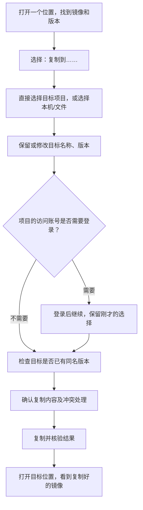

# 镜像管理：面向普通用户的流程讨论稿

状态：2026-10-27，产品流程提案，供讨论。本文描述期望的使用体验，
不代表这些能力已经全部实现。本轮只整理文档，不执行镜像删除。
英文主文档见 [user-journeys.md](user-journeys.md)，当前程序行为见
[workspace.md](workspace.md)。

## 三个主要对象：项目、镜像、镜像文件

**项目：集中管理一组镜像的地方，也是上传时主要选择的目标。**
展示项目名称和所属仓库，帮助用户分清同名项目。

**镜像：一个准备交付的软件包。** 先展示软件包名称和版本，本机镜像自动读取，
不要求用户先给它指定远端项目。版本名称就是 Tag，复制时可以修改目标名称和版本。

**镜像文件：镜像导出后的可携带副本。** 文件可能包含多个镜像或多个平台，
可以检查后导入不同项目；它不永久绑定某个项目，也不携带访问账号的秘密。

仓库服务负责地址和连接，凭证负责访问身份，分别作为项目的支撑。
同一个项目可以有多个访问账号；同一个账号也可能在不同项目里有不同权限。
详细定义与示例见[项目与访问模型](project-model.zh-CN.md)。
Commander 模式的具体交互见[传输工作台讨论稿](transfer-workspace.zh-CN.md)：
两边顶部各用一个下拉框，直接选择具体仓库、本机镜像引擎或文件系统目录，
统一入口管理这些目标；下方树形或列表浏览，选中镜像复制，底部显示队列和结果。

## 场景一：添加项目，并准备好访问方式

用户的想法是：“让我能在这里找到公司的这个项目，并管理里面的镜像。”

1. 选择“添加项目”。选择已有仓库服务，或填写管理员提供的新仓库地址。
2. 选择已有账号、添加账号，或者使用允许的匿名访问。
   多个账号共享同一个仓库服务地址，不重复建立相同的仓库和项目。
3. 系统读取这个身份能发现的项目，用户选择要加入列表的项目。
   不支持列举时，可以填写确切的已有项目或命名空间，并说明映射方式。
4. 项目只出现一次，下面保留不同账号的访问方式和已确认权限。
   地址错误、连接失败、登录失败、没有权限、项目确实为空，要分别说明。
5. 如果是在复制时添加项目，完成后返回刚才的复制，选中新加入的项目并保留输入。

“添加项目”这里表示把已有项目加入工具，不会隐式在远端创建项目。
“在远端新建项目”是另一项需要明确权限与确认的操作。

登录过期时，项目仍然存在，提示重新登录并继续。
“移除账号”只删除这个访问凭证，“移除项目快捷入口”只删除本地记录，
都不会删除远端镜像。登录不等于具备查看、上传和删除的全部权限。

## 场景二：把一个镜像复制到另一个位置

用户的想法是：“把这份软件包放到那里，原来的先留着。”

以“把本机的订单服务 1.4 放到测试项目”为例：

1. 打开“本机镜像”，找到“订单服务 · 1.4”。
2. 选择“复制到……”。
3. 直接选择“测试项目 · 公司仓库”。列表同时显示所属仓库，区分同名项目；
   不要求用户先选账号或手动拼接完整路径。缺少项目时可以在这里添加。
4. 系统带入镜像名称和版本，用户可以改成目标需要的名字。
5. 使用这个项目的上传账号，必要时提示“登录以继续复制到测试项目”。
   有多个适用账号时允许选择，并提供查看、更换入口；不会自动切换到权限最大的账号。
6. 确认内容：“把本机的订单服务 1.4 复制到公司仓库 / 测试项目；本机原件保留。”
7. 点击“开始复制”。任务显示“等待中 / 正在上传 / 正在核验 / 已完成”。
8. 完成后选择“打开目标位置”，在那里看到这份镜像，而不只是看到一条成功日志。

普通复制只需一次清楚的确认。目标已经存在不同内容的同名版本时，才增加冲突选择：
“换一个版本名称”“明确替换”“跳过”。如果目标已经是相同内容，应说明“这里已有
相同镜像”，提供打开目标，不再制造一次无意义的上传。

### 同一个复制概念，几种不同方向

| 用户操作 | 用户看到的结果 |
| --- | --- |
| 本机镜像 → 项目 | 项目里增加一份可找到的镜像，本机原件保留 |
| 项目 A → 项目 B | 目标项目增加副本，来源读取和目标上传分别使用所选账号 |
| 项目 → 本机镜像 | 本机镜像列表中出现这份镜像 |
| 某个位置 → 归档文件 | 在选定文件夹里保存一个可携带的镜像文件 |
| 归档文件 → 某个位置 | 检查文件内容后，把选中的镜像放入目标位置 |
| 同一项目内复制为另一个名称或版本 | 多出一个名字，原来的名字保留 |

这是期望覆盖的产品流程，不是现有功能清单。特别是“放到本机镜像列表”和
“保存成一个文件”必须明确区分；不能用生成一个 tar 文件代替用户想要的本机镜像。

复制默认应保留用户所选镜像的完整平台范围。只需要某个平台时再明确选择，
不能因为当前电脑是什么芯片就悄悄缩小复制内容。当前程序的远端流程仍需选择
单个平台，这一点属于后续实现与本提案之间的差距。

### 失败之后怎么继续

- 登录失败：留在原来的任务上，允许重新输入或更换账号。
- 没有添加镜像的权限：说明具体目标不能写入，允许换项目、换账号或换位置。
- 目标项目不存在：引导重新选择；不会悄悄替用户创建一个项目。
- 网络中断：检查目标是否已经收到，再决定是否重试，避免结果不明确时盲目重复。
- 用户取消：请求停止，并说明实际完成到哪里；不承诺自动撤销已经写入的内容。
- 批量复制部分成功：逐项展示结果，只重试需要处理的项。

无论发生什么，都尽量保留用户刚才的选择和输入。

## 场景三：删除某个位置上的镜像，或清理一批内容

用户的想法是：“这里这份我不要了。”

先从当前项目或本机上的具体镜像开始，操作名称用“从本机删除……”或“从测试项目删除……”。
不要只写一个范围不明确的“删除镜像”。

1. 用户选择具体镜像和版本。
2. 系统分别确认当前账号的删除权限与实际影响范围，上传权限不代表可以删除。
   弄清实际会发生什么：只移除这个版本名字，还是也影响
   同一内容的其他名字；是否涉及整个镜像组。
3. 展示简短确认。例如：“从本机删除订单服务 1.3？公司仓库里的副本仍然保留。”
   如果还会影响其他名字，必须列出来；不能把一个名称的删除悄悄扩大为全部删除。
4. 用户确认后执行。若确认后内容或影响范围已变，重新确认，不沿用旧的选择。
5. 检查结果，刷新当前位置。多项删除分别报告成功、失败和待核实的结果。

如果底层无法实现“只删除这个名字”，应解释实际可用的删除方式和影响。
不能确认范围时，不提供这个删除操作。

本机镜像如果已知正在被使用，应解释原因并阻止普通删除；本工具不代替用户停止
运行中的工作，也不自动强制删除。不能判断是否在使用时，就明确说明不能判断。

“从列表消失”不等于“磁盘已经释放同等空间”。清理结果只报告已经确认的事实，
不把镜像大小简单相加后当成保证可释放的空间。

### 清理可以复用同一套删除流程

“清理这个位置”先帮助用户筛选和查看候选项，再由用户选择、确认和删除。
旧版本、没有标签、体积大等可以作为筛选条件，不能直接等同于“可以放心删除”。
初版不默认勾选候选项，也不把仓库存储层的垃圾回收混成一个普通删除按钮。

复制成功后，可以给出两个独立的后续动作：

- “打开目标位置”：确认软件包已经在那里。
- “删除原位置的副本……”：进入正常删除确认，明确影响范围。

删除原件不自动执行、不默认勾选。复制失败或结果尚未核实，不能把目标描述成
已经备份成功。自动“移动”不属于第一阶段流程。

## 用户界面应该怎样说

| 情况 | 示例文案 |
| --- | --- |
| 初次进入 | 选择一份软件包，以及你想把它放到哪里。 |
| 添加项目 | 选择要在这里管理镜像的项目。 |
| 复制时需要登录 | 登录以继续复制到“测试项目 · 公司仓库”。 |
| 登录过期 | 登录已过期，重新登录后可继续刚才的操作。 |
| 版本冲突 | 这里已有另一个同名版本，请换一个名称或明确替换。 |
| 完成 | 已复制到“公司仓库 / 测试项目”。打开目标位置。 |
| 删除确认 | 从“本机镜像”删除所选内容？其他受影响的版本名称如下。 |
| 结果不明确 | 连接中断，先检查目标位置，再决定是否重试。 |

上述文案必须符合实际结果。例如，只有已经确认账号能查看但不能上传时，
才能说“你可以查看，但不能在这里添加镜像”。详细错误可以展开查看，普通流程
不要求用户先理解摘要、清单、导出、归一化或 push 命令。

## 下一步用这些场景检验设计

先让第一次使用的人，在不接受命令行教学的情况下完成：

1. 找到一个本机镜像，分清镜像名称、版本和所在位置。
2. 在复制过程中添加项目，必要时配置仓库和账号，登录后继续原来的复制。
3. 在目标位置找到复制结果，同时确认原件仍然存在。
4. 分清“复制到本机”和“保存归档文件”。
5. 处理一次登录过期或同名版本冲突，不必从头再来。
6. 删除前说清楚会影响哪个项目或本机、哪些名字、其他副本是否保留。
7. 用不同账号访问同一个项目时，仍能认出它是同一个项目，理解权限各自独立。

先确定这些流程，再推导页面、导航和按钮，不以目前的左右面板或弹窗为限制。
